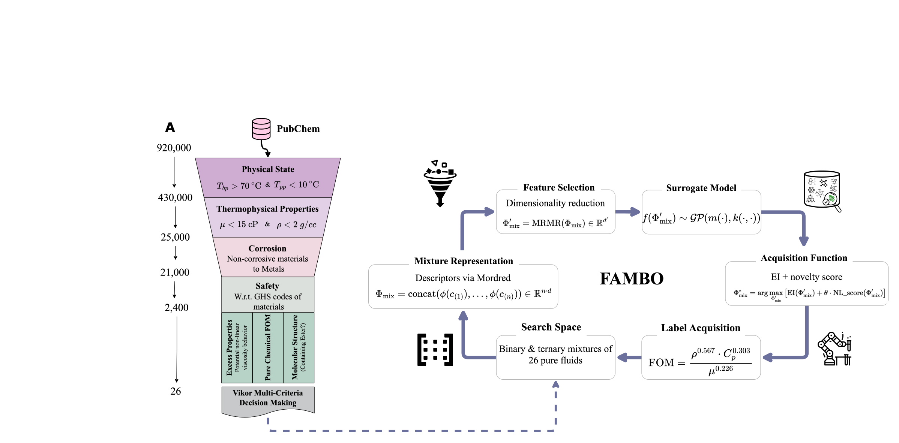

# Self-Driving Discovery of Electric Vehicle Coolants

<p align="center">
  
</p>


This repository contains the implementation of the computational
screening framework presented in:

> **Self-Driving Discovery of Electric Vehicle Coolants**

The framework enables autonomous identification of high-performance
coolant candidates through a modular, multi-stage pipeline integrating
data acquisition, machine learning property prediction, mixture behavior
modeling, structural filtering, and multi-criteria decision analysis
(VIKOR).

------------------------------------------------------------------------

## 🔬 Workflow Overview

The discovery pipeline follows a structured screening funnel:

1.  **PubChem Acquisition**\
    Automated retrieval of molecular structures and identifiers.

2.  **SMILES Validation & Structural Filtering**

    -   Removal of invalid SMILES\
    -   Substructure screening (e.g., ester detection)

3.  **Thermophysical Property Prediction (ML Models)**\
    Machine learning models trained to predict:

    -   Density\
    -   Heat capacity\
    -   Boiling point\
    -   Melting point\
    -   Corrosion\

4.  **Dynamic Viscosity Prediction**\
    Ensemble-based model for viscosity estimation.

5.  **Mixture Non-Linearity & Excess Property Screening**\
    Identification of favorable non-ideal mixture behavior.

6.  **VIKOR Multi-Criteria Ranking**\
    Final prioritization using weighted multi-objective optimization.

------------------------------------------------------------------------

## 📁 Repository Structure

    data/                # Input and processed datasets
    notebooks/           # Jupyter notebooks for experiments and analysis
    src/filters/         # Modular screening and filtering modules
    requirements.txt     # Python dependencies
    README.md

------------------------------------------------------------------------

## ⚙️ Installation

### Recommended (Conda Environment)

``` bash
conda create -n evcoolants python=3.10
conda activate evcoolants
conda install -c conda-forge rdkit
pip install -r requirements.txt
```

------------------------------------------------------------------------

## 📜 License

****

------------------------------------------------------------------------

## 📖 Citation

If you use this code, please cite:

Self-Driving Discovery of Electric Vehicle Coolants\
\<Journal Name, Year\>\
`<DOI>`{=html}

------------------------------------------------------------------------

## 👤 Author

Mahyar Rajabi Kochi\
AI4ChemS - University of Toronto
